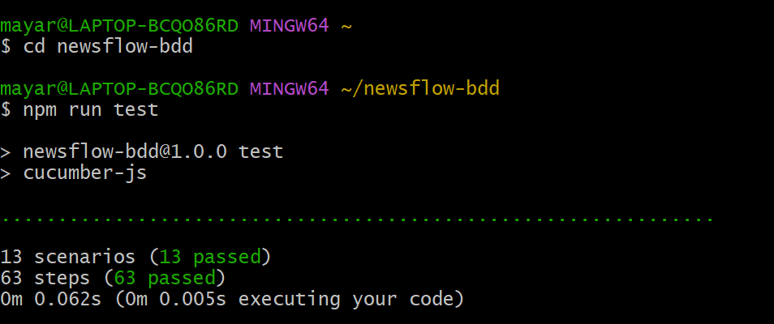
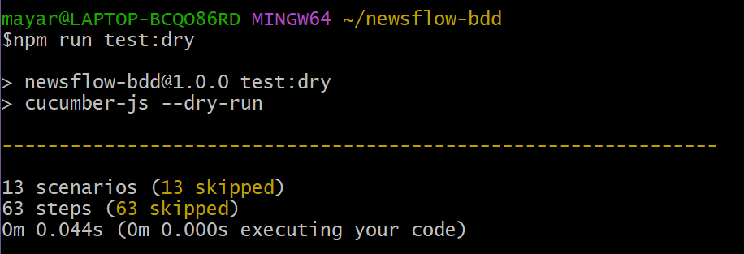

# NewsFlow - Testes BDD

## Como executar os testes
1. Instale as dependências: `npm install`
2. Execute a suíte de testes: `npm test`
3. Abra o arquivo `relatorios/cucumber-report.html` no navegador para ver o relatório detalhado.

## Fora de escopo
* **RN01 (Rascunho):** Focamos no fluxo principal de envio; o salvamento será tratado na próxima sprint de melhorias do editor.
* **RN05 (Frequência):** A regra de enfileiramento para a semana seguinte exige integração com o motor de mensageria, priorizado para a etapa 2.
* **RN06 (Descadastro):** O fluxo de duplo opt-in será desenvolvido junto com o portal do assinante.
* **RN07 (Falha de entrega):** A gestão de hard/soft bounces será automatizada após a consolidação do agendamento básico.

## Saída da Execução (npm test)

## Saída da Execução (npm run test:dry)

